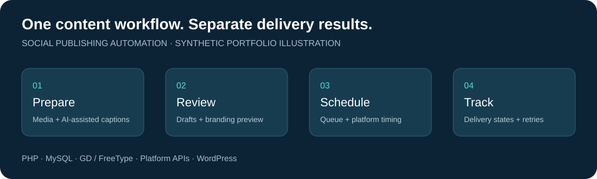
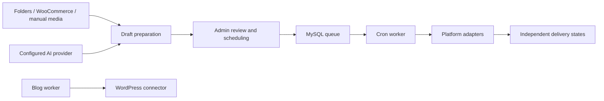

# Social Publishing Automation

A PHP and MySQL publishing workspace for teams that prepare content once, review drafts, and schedule delivery across business social accounts. Includes AI-assisted captions, local image branding, and a WordPress blog connector.

**Portfolio edition:** This is anonymized application source for technical review. Business names, contacts and integration namespaces use fictional examples. Credentials, customer media, database records, deployment history and operational logs are excluded. External integrations require the reviewer's own accounts and approvals; this repository is not a hosted demo.



*Original illustration of the workflow, not a screenshot or live delivery report.*

## Business problem and implementation

Managing separate captions, media, schedules and retry states across several business accounts creates repetitive work. This project centralizes preparation while retaining separate delivery results for each destination. The implementation covers the admin interface, SQL schema, provider adapters, scheduled workers and image-processing pipeline.

## Capabilities

- Import product content from WooCommerce or use server-side content folders and manually supplied media.
- Generate captions through OpenAI-compatible, Anthropic and Qwen integrations; supply writing examples and per-page instructions.
- Reuse saved captions across destinations, without regenerating AI copy during delivery retries.
- Schedule Facebook, Instagram, LinkedIn organization and TikTok deliveries through separate platform adapters. Actual media support and publishing eligibility depend on each platform's API and app approval.
- Track delivery failures, retry attempts, notifications and analytics in the administration interface.
- Render horizontal branding pills with Unicode symbols, text/border colors, independent fill opacity, and size-to-fit positioning. GD companion fonts handle supplementary glyphs; supersampling smooths rounded borders.
- Prepare WordPress articles and SEO fields through an authenticated connector, with a separate blog worker.
- Protect admin requests with sessions and CSRF checks; encrypt stored integration credentials using Sodium.

## Workflow



## Source map

| Area | Implementation |
| --- | --- |
| Admin UI and requests | [public/index.php](public/index.php) |
| Queue worker | [cron/publish.php](cron/publish.php) |
| AI adapters | [app/Services/AI](app/Services/AI) |
| Image branding | [ImageBrandingService.php](app/Services/ImageBrandingService.php), [BrandingText.php](app/Services/BrandingText.php) |
| Browser branding preview | [branding-preview.js](public/assets/branding-preview.js) |
| Platform delivery | [app/Services](app/Services) |
| Schema and upgrades | [database/migrations](database/migrations), [DatabaseUpgradeService.php](app/Services/DatabaseUpgradeService.php) |
| WordPress connector | [wordpress-plugin/example-studio-blog-connector](wordpress-plugin/example-studio-blog-connector) |
| Branding regression checks | [tests/branding-pills.php](tests/branding-pills.php) |

## Setup for evaluation

Use PHP 8.1+ with PDO MySQL, cURL, JSON, OpenSSL, Sodium, mbstring and GD with FreeType, plus MySQL and an HTTPS web server. Source uses a small built-in autoloader; there is no Composer install step.

1. Create an isolated database. Import `database/migrations/001_initial.sql`.
2. Copy `.env.example` to `.env`. Configure the database and evaluation URL. Generate independent random values for `APP_KEY` and `SETUP_KEY`:
   ```sh
   php -r 'echo bin2hex(random_bytes(32)), PHP_EOL;'
   ```
3. Create writable runtime directories:
   ```sh
   mkdir -p storage/logs page-content
   ```
4. Serve only `public/` as the document root. Keep `.env` and application files outside the web root.
5. Open `/setup.php`, use your setup key and create your administrator. Remove that script and clear `SETUP_KEY` afterwards. Use `/server-check.php` for basic extension checks, then remove it.
6. Sign in and run **Database Upgrade** before using additional features. The migration directory includes historical overlapping version numbers; do not blindly import every SQL file into an already upgraded database.
7. Configure fictional content first. Leave platform credentials empty and do not enable scheduled workers during source/UI evaluation.

For authorized integration testing, configure your own platform credentials and exact OAuth redirect URLs in `.env`. Confirm API versions and permissions against the provider's current documentation. Meta Page tokens and AI keys can be configured in the UI. LinkedIn organization publishing and TikTok posting require appropriate platform access; source availability does not imply approval.

The optional WordPress plugin exposes the anonymized `example-studio/v1` namespace. Install it on a test WordPress site and use an application password belonging to a user with suitable post capabilities. Both the plugin and PHP client use that same namespace.

Only after deliberate configuration, invoke `php cron/publish.php` and/or `php cron/blog.php` using your scheduler. **These workers can publish real posts; this edition has no universal dry-run mode.** AI generation may incur provider charges. Keep production accounts disconnected during evaluation.

## Validation

Syntax checking and offline Unicode coverage checks were run with a PHP 8.2 WebAssembly runtime against this sanitized copy. No production configuration or external publishing calls were used. Full database, OAuth and platform end-to-end tests are not included in those checks.

On native PHP with GD and FreeType, run:

```sh
find app config cron public tests wordpress-plugin -name '*.php' -exec php -l {} \;
php tests/branding-pills.php
```

The branding test covers pill layout, nine positions, independent opacity, unsupported glyph handling, portrait fit and antialiased borders. Its full native rendering run has not been repeated for this portfolio edition.

Bundled Noto fonts retain their [SIL Open Font License](public/assets/branding-fonts/OFL.txt) and [derivative notice](public/assets/branding-fonts/GD-FONTS-NOTICE.txt). The optional font rebuild script requires Python and `fonttools`. No general source-code reuse license has been added.

## Relevant project work

PHP application development, API integrations, OAuth flows, content automation, MySQL job queues, WordPress REST integration, multilingual typography and image processing.
